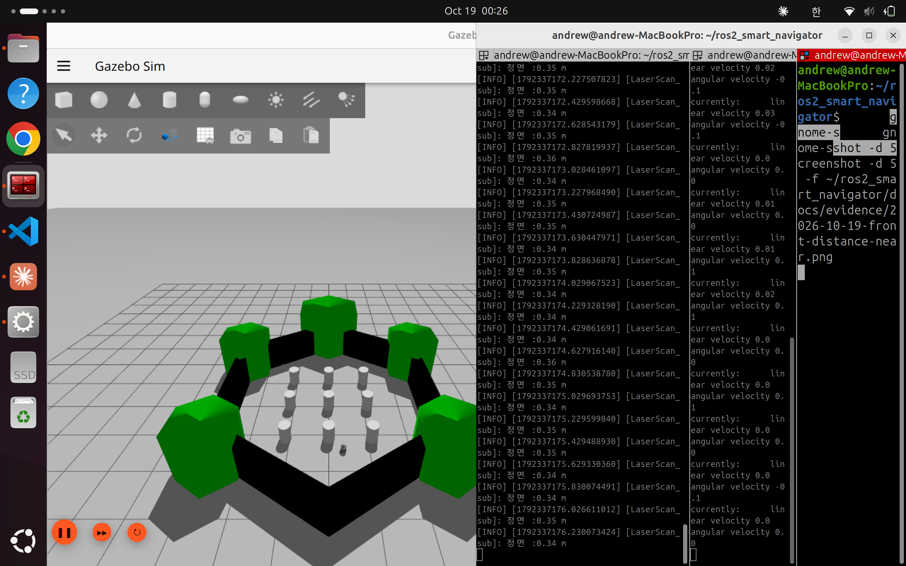
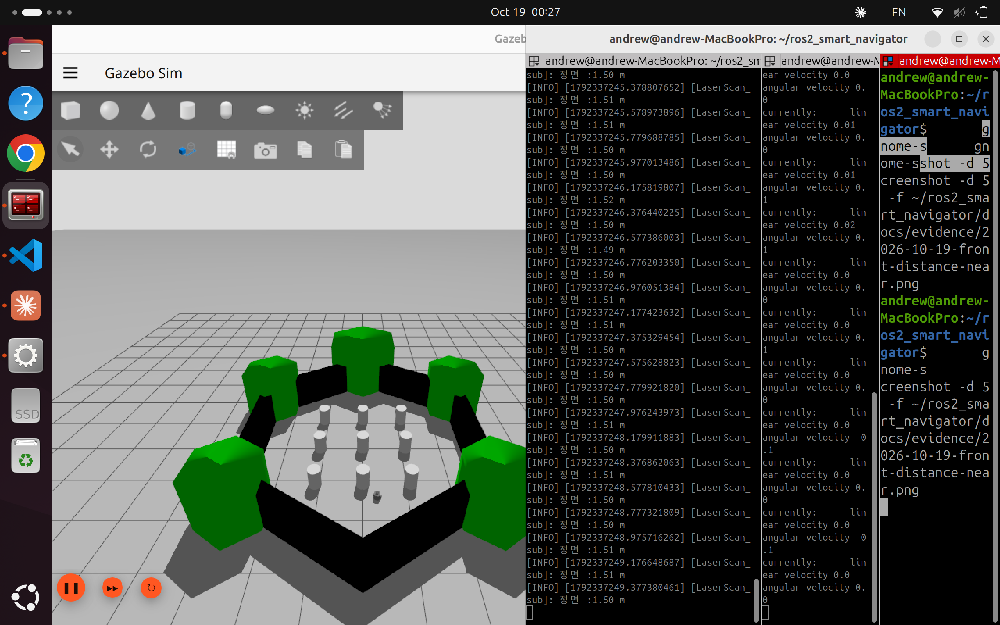

# 테스트 시나리오

> 1일차 완료 기준: 테스트 시나리오 초안. 세부 항목은 각 담당자가 작업 진행에 따라 추가한다.

## 통합 테스트 시나리오 (초안)

1. 시뮬레이션 실행: `export TURTLEBOT3_MODEL=burger` 후 `ros2 launch turtlebot3_gazebo turtlebot3_world.launch.py` (자체 제작 맵 준비 후 갱신)
2. 토픽 확인: `ros2 topic list`, `ros2 topic info /scan`, `ros2 topic info /cmd_vel`
3. 장애물 감지 테스트 (3일차 이후, B 작성)
   - 단위 테스트: `src/obstacle_detector/test/test_front_distance.py` (`colcon test --packages-select obstacle_detector`) — 정면 좌우 15도 경계, `inf`/`NaN`, 센서 범위 밖 값, 유효값 없음, 잘못된 스캔, `front_deg` 변경
4. 장애물 회피 테스트 (4~5일차 이후, C 작성)
5. 통합 실행 테스트 (6일차 이후, A 작성)
6. QoS 비교 실험 테스트 (8~10일차, A·B·C 공동 작성)

## 완료 기준(초안)

- 사전 정의한 10회 테스트 중 8회 이상 안전 회피 또는 정지 (`plans.md` 8장 참고)

## 장애물 거리별 테스트 케이스 (3일차, 공동)

### A. 회피 판정 (`avoider`) — Gazebo 불필요

`avoider`의 기본 파라미터(`slow_dist`=1.0 m, `stop_dist`=0.5 m, `recover_dist`=1.5 m, `linear_x`=0.2, `angular_z`=0.5, `stop_time`=0.3 s, `recover_time`=1.0 s, `scan_timeout`=0.5 s) 기준이다. `/obstacle/front_distance`를 직접 발행해 거리를 흉내 낸다.

**재현 방법** (터미널 2개, 각각 `source install/setup.bash` 먼저)

```bash
ros2 run obstacle_avoider avoider
```

```bash
ros2 topic pub -r 10 /obstacle/front_distance std_msgs/msg/Float32 "{data: 0.8}"
```

- 발행은 반드시 `-r 10`처럼 반복한다. 0.5초(`scan_timeout`) 넘게 수신이 없으면 안전 정지한다.
- 거리를 바꾸려면 `Ctrl+C` 후 값을 바꿔 다시 발행한다. 이 사이에 잠시 `front_min=None`이 찍히는 것은 정상이다(TC-A11과 같은 동작).
- `inf`는 `{data: .inf}`로 발행한다.
- 이미 시뮬레이션이 떠 있으면 `/cmd_vel`이 섞이므로, 다른 `ROS_DOMAIN_ID`를 쓰거나 시뮬레이션을 끈다.
- 결과는 `avoider` 로그(`state=... front_min=... cmd=(선속도, 각속도)`)로 확인한다.

| ID | 시작 상태 | 입력 거리 | 기대 결과 | 결과 |
|---|---|---|---|---|
| TC-A1 | FORWARD | 2.0 m | `FORWARD` 유지, cmd=(0.20, 0.00) | 통과 |
| TC-A2 | FORWARD | 0.8 m | `FORWARD -> SLOW`, cmd=(0.10, 0.00) | 통과 |
| TC-A3 | FORWARD | 1.0 m (경계) | `FORWARD` 유지. `< 1.0`이 아니므로 감속하지 않음 | 통과 |
| TC-A4 | FORWARD | 0.5 m (경계) | `FORWARD -> SLOW`. `< 0.5`가 아니므로 정지하지 않음 | 통과 |
| TC-A5 | FORWARD | 0.4 m | `FORWARD -> STOP`, 0.3 s 뒤 `STOP -> ROTATE`, cmd=(0.00, 0.50) | 통과 |
| TC-A6 | ROTATE | 0.4 m 후 1.2 m | `ROTATE` 유지 (1.5 m 초과해야 복귀, 히스테리시스) | 통과 |
| TC-A7 | ROTATE | 0.4 m 후 2.0 m | `ROTATE -> RECOVER`(cmd=(0.20, 0.00)), 1.0 s 뒤 `RECOVER -> FORWARD` | 통과 |
| TC-A8 | SLOW | 0.8 m 후 1.2 m | `SLOW` 유지 (1.5 m 초과해야 복귀) | 통과 |
| TC-A9 | SLOW | 0.8 m 후 2.0 m | `SLOW -> FORWARD` | 통과 |
| TC-A10 | FORWARD | `inf` (유효값 없음) | `FORWARD` 유지, cmd=(0.20, 0.00) | 통과 |
| TC-A11 | 임의 | 0.5 s 넘게 수신 없음 | `front_min=None`, cmd=(0.00, 0.00) 안전 정지 | 통과 |

- 결과 열은 2026-10-19 Claude가 시뮬레이션과 분리된 환경(`ROS_DOMAIN_ID=77`)에서 위 재현 방법으로 실행하고 `avoider` 로그로 확인한 것이다. 실행 로그 파일은 저장하지 않았다.
- 참고: 상태가 바뀌는 순간의 로그 한 줄은 `state`는 새 상태, `cmd`는 직전 상태의 값이 찍힌다(예: `state=STOP ... cmd=(0.20, 0.00)`). 로그가 1초마다, 상태 전환 판정 뒤에 출력되기 때문이며 실제 발행 동작과는 다르다.

### B. 감지 (`detector_node`) — 시뮬레이션

| ID | 상황 | 기대 결과 | 결과 |
|---|---|---|---|
| TC-B1 | 정면이 가까운 물체(약 0.35 m)를 향함 | `/obstacle/front_distance`가 약 0.35 | 통과 (`LaserScan_sub` 로그와 스크린샷, 검증 기록 참고) |
| TC-B2 | 정면이 먼 곳(약 1.5 m)을 향함 | 약 1.5 | 통과 (위와 같음) |
| TC-B3 | 정면 좌우 15도 밖 측면 물체가 정면보다 가까움 | 거리에 영향 없음 | 통과 (아래 상세) |
| TC-B4 | 정면 0.5 m 이내 물체 앞에서 `avoider` 실행 | 정지 후 회전, 전방이 비면 재주행 | 통과 (A의 구두 확인, 증거 없음) |

**TC-B3 상세 (2026-10-19, Claude 실행)**

- 방법: GUI 없는 시뮬레이션(`turtlebot3_world`, 시작 위치 x=-2.0, y=-0.5)과 `detector_node`를 별도 환경(`ROS_DOMAIN_ID=77`, `GZ_PARTITION`)에서 띄우고, 로봇을 제자리에서 0.5 rad/s로 약 14초(한 바퀴 안팎) 회전시키며 0.5초마다 `/scan`과 `/obstacle/front_distance`를 같은 시점에 기록했다. `/scan`에서 정면(-15~+15도), 좌(+16~+90도), 우(-90~-16도) 구간의 최소 유효 거리를 따로 계산해 토픽 값과 비교했다.
- 결과: 27개 샘플 모두에서 `/obstacle/front_distance`가 `/scan` 정면 구간 최소값과 일치했다(불일치 0건). 측면 물체가 정면보다 0.3 m 넘게 가까운 샘플이 12건 있었고, 이 경우에도 토픽은 정면 값을 유지했다. 예: 정면 1.13 m, 좌측 0.52 m일 때 토픽 값은 1.13 m. 정면 1.59 m, 좌측 0.60 m일 때 1.59 m.
- 한계: 측면 구간은 +16~+90도, -90~-16도만 비교했고, 후방은 비교하지 않았다. 비교용 계산이 `detector_node`와 같은 구간 정의를 쓰므로 "구간 경계 정의가 맞는지"가 아니라 "측면 값이 정면 값에 섞이지 않는지"를 확인한 것이다. 경계 각도(±15도) 자체는 단위 테스트가 검증한다. 원시 기록 파일은 저장하지 않았다.

### C. 거리 계산 단위 테스트

`colcon test --packages-select obstacle_detector`로 `src/obstacle_detector/test/test_front_distance.py` 8건을 실행한다. 정면 좌우 15도 경계, `inf`/`NaN`, 센서 범위 밖 값, 유효값 없음, 잘못된 스캔, `front_deg` 변경을 확인한다.

## 검증 기록

### 2026-10-19 — 정면 거리 출력 확인 (3일차, A)

| 항목 | 내용 |
|---|---|
| 일시 / 확인자 | 2026-10-19 00:26~00:27 / A |
| 대상 | `sensor_monitor/LaserScan_sub` (정면 좌우 15도, `inf`/`NaN`·센서 범위 밖 제외 후 최소 거리) |
| 환경 | ROS 2 Jazzy, Gazebo Harmonic, TurtleBot3 Burger, `turtlebot3_world` |
| 절차 | `turtlebot3_world.launch.py`, `LaserScan_sub`, `teleop_keyboard`를 각각 실행하고 teleop으로 로봇을 움직이며 로그를 확인 |
| 증거 | 아래 스크린샷 2장 (Gazebo 화면 + `LaserScan_sub` 로그 + teleop 터미널) |

| 상황 | 로그 값 | 스크린샷 |
|---|---|---|
| 정면이 가까운 물체를 향함 | `정면 :0.34 m` ~ `0.36 m` | [near](evidence/3-days-result/2026-10-19-front-distance-near.png) |
| 정면이 먼 곳을 향함 | `정면 :1.49 m` ~ `1.52 m` | [far](evidence/3-days-result/2026-10-19-front-distance-far.png) |




**판정: 부분 통과.** 정면 거리가 상황에 따라 다른 값으로 출력되고, 두 상황 모두 값이 ±0.02 m 이내로 안정적임을 확인했다. 이전의 "항상 `정면: 장애물 없음`" 증상(유효값 필터 반전 버그)은 나타나지 않았다.

확인하지 못한 항목 (미확인):

- 두 스크린샷에서 Gazebo의 로봇 위치가 거의 같다. 제자리 회전으로 방향을 바꿔 찍은 것으로 보이며, 벽에 접근하면서 값이 연속으로 줄어드는 과정은 이 자료에 없다.
- 정면 좌우 15도 밖의 물체가 거리에 영향을 주지 않는지는 시뮬레이션에서 확인하지 않았다.
- `inf`/`NaN`, 센서 범위 밖 값, 경계 각도는 시뮬레이션이 아니라 단위 테스트(`test_front_distance.py`)로만 확인했다.
- 이 스크린샷이 `detector_node`/공통 함수 도입(`docs/history/2026-10-19-detector-topic-split.md`) 이전 빌드인지 이후 빌드인지 구분하지 않았다. 공통 함수 도입 후의 `detector_node` → `avoider` 연동은 시뮬레이션에서 확인되지 않았다.

### 2026-10-19 — `detector_node` → `avoider` 연동 확인 (3일차, A)

| 항목 | 내용 |
|---|---|
| 일시 / 확인자 | 2026-10-19 / A |
| 대상 | `detector_node`(`/scan` → `/obstacle/front_distance`), `avoider`(`/obstacle/front_distance` → `/cmd_vel`) |
| 절차 | 시뮬레이션, `detector_node`, `ros2 topic echo /obstacle/front_distance`, `avoider`를 순서대로 실행하고 로봇의 동작과 로그를 확인 |
| 기대 결과 | 거리 토픽 발행, 거리에 따른 `FORWARD`/`SLOW`/`STOP`/`ROTATE`/`RECOVER` 전환, `detector_node` 종료 시 안전 정지 |
| 실제 결과 | 확인자가 안내된 절차 전체가 기대대로 동작한다고 확인함 |
| 판정 | 통과 |

참고: 이 확인은 확인자의 구두 보고이며, 로그·스크린샷 증거는 첨부하지 않았다. 거리 값과 상태 전환의 구체적인 로그, `detector_node` 종료 시 안전 정지, 정면 좌우 15도 밖 측면 벽 확인 여부는 기록하지 않았다.

### 2026-10-25 — 5일차 통합 테스트 (A)

| 항목 | 내용 |
|---|---|
| 일시 / 확인자 | 2026-10-25 / A |
| 대상 | B의 NaN/±inf 처리(`front_distance`, `LaserScan_sub`), C의 센티널 안전 처리와 stuck 후진·회전 복구(`avoider`, `safety`) |
| 환경 | ROS 2 Jazzy, Gazebo Harmonic, TurtleBot3 Burger, `warehouse` |
| 절차 | 1) 단위 테스트 2) Gazebo 없이 `/obstacle/front_distance`를 직접 발행해 `avoider` 판정 확인 3) `avoid.launch.py world:=warehouse x_pose:=<x> y_pose:=<y>`로 자동 주행, 회차당 70초 감시 |
| 감시 방법 | 주행 중 `/scan`, `/odom`, `/cmd_vel`, `/obstacle/front_distance`를 기록하는 스크립트를 함께 실행하고, `avoider` 로그의 상태 전환을 대조 |
| 접촉 판정 기준 | 감시 구간 중 `/scan` 전체 방향 최소 거리가 0.15 m 이하이면 접촉 의심. 센서 최소 거리는 0.12 m |

#### 1. 단위 테스트

| 패키지 | 결과 |
|---|---|
| `obstacle_detector` | 통과 (20건, 건너뜀 1건: `test_copyright`) |
| `obstacle_avoider` | 통과 (10건, 건너뜀 1건: `test_copyright`) |

#### 2. `avoider` 판정 확인 (Gazebo 없음)

| ID | 입력 거리 | 기대 결과 | 실제 결과 | 판정 |
|---|---|---|---|---|
| TC-5-1 | `nan` | 상태 유지, `cmd=(0.00, 0.00)`, 로그 `front_min=nan` | 기대와 같음 | 통과 |
| TC-5-2 | `.inf` | `front_min=+inf`, 전진 (선속도 0.2) | 기대와 같음 | 통과 |
| TC-5-3 | 0.8 | `SLOW`, 선속도 0.1 | 기대와 같음 | 통과 |
| TC-5-4 | 0.4 | `STOP` → 0.3초 뒤 `ROTATE` | 기대와 같음 | 통과 |
| TC-5-5 | `-.inf` | `too close` → `BACK` → `TURN` | 기대와 같음 | 통과 |
| TC-5-6 | 발행 중단 | 0.5초 뒤 `front_min=None`, 정지 | 기대와 같음 | 통과 |

#### 3. 자동 주행 시나리오 (`warehouse`)

시작 방향(yaw)은 launch 인자가 없어 바꿀 수 없다. 로봇은 항상 +x 방향으로 출발한다. 아래 "정면 대상"은 시작 위치와 `warehouse.world` 배치로 추정한 것이며, 로봇이 실제로 부딪힐 뻔한 물체 이름은 확인하지 않았다 (미확인).

**3-1. 정지·회피 판정 대상 10회** (정지 거리는 정지 직전 `/obstacle/front_distance`)

| 회차 | 시작 위치 (`x_pose`, `y_pose`) | 정면 대상 | 상태 전환 | 정지 거리 | 전체 방향 최소 거리 | 결과 |
|---|---|---|---|---|---|---|
| 1 | (8.0, 0.0) | 미확인 | `SLOW→STOP→ROTATE→RECOVER→FORWARD` 반복 | 0.50, 0.49 m | 0.458 m | 통과 |
| 2 | (0.0, -8.0) | 미확인 | 위와 같음 | 0.48 m | 0.447 m | 통과 |
| 3 | (-6.0, 8.0) | 미확인 | 위와 같음 | 0.50, 0.50 m | 0.355 m | 통과 |
| 4 | (4.0, 3.0) | 미확인 | 위와 같음 | 0.47, 0.48 m | 0.278 m | 통과 |
| 5 | (11.0, -2.0) | 미확인 | 위와 같음 | 0.50, 0.47 m | 0.423 m | 통과 |
| 6 | (-3.0, -2.0) | 선반(`shelf_7`, 추정) | 위와 같음 | 0.49 m | 0.447 m | 통과 |
| 7 | (7.0, 4.5) | 선반(`shelf_4`, 추정) | 위와 같음 | 0.48 m | 0.424 m | 통과 |
| 8 | (9.0, -15.0) | 선반(`shelf_6`, 추정) | 위와 같음 | 0.49 m | **0.12 m** | **실패 (접촉 의심)** |
| 9 | (1.0, -13.0) | 선반(`shelf_big_1`, 추정) | 위와 같음 | 0.49 m | 0.343 m | 통과 |
| 10 | (-6.0, -13.0) | 선반(`shelf_big_2`, 추정) | `SLOW→STOP→ROTATE→RECOVER→FORWARD` | 기록 못함 (상태 전환 로그로 STOP 확인) | 0.44 m | 통과 |

통과 9 / 10회 (완료 기준: 8회 이상 → 충족). 8회는 정지·회전은 정상이었지만 전체 방향 최소 거리가 센서 최소값(0.12 m)까지 내려가 접촉 가능성이 있어 실패로 센다.

**3-2. 판정 대상에서 제외한 회차** (같은 방법으로 실행했으나 정지·회피 판정에는 쓸 수 없음)

| 시작 위치 | 관찰 | 제외 이유 |
|---|---|---|
| (-2.0, -0.5) | 70초 동안 직진만 하고 `SLOW`까지만 전환, 정지 없음. 최소 거리 0.212 m | 정면 장애물을 만나지 못해 정지 동작 미발동. 접촉 의심 기준(0.15 m)보다는 멀었음 |
| (-6.0, -0.5) | 위와 같음. 최소 거리 0.22 m | 위와 같음 |
| (-2.0, 5.0) | 위와 같음. 최소 거리 0.16 m | 위와 같음. 기준에 근접 |
| (5.0, -6.0) | 감시 시작 시점부터 이동 거리 0, 최소 거리 0.12 m. `stuck` 3회 → `GAVE_UP` | 스폰 직후 장애물에 끼인 것으로 보임 (스폰 위치 불량 의심, 미확인) |
| (-8.0, -8.0) | 위와 같음 | 위와 같음 |

참고: (5.0, -6.0)과 (-8.0, -8.0)에서는 정면 거리가 `+inf`인데도 최소 거리가 0.12 m였다. 장애물이 정면 좌우 15도 밖(측면·후방)에 있었다는 뜻이며, 이때는 정지 감지(`stuck`)가 3회 복구 후 `GAVE_UP`으로 정지시켜 주었다.

#### 4. 발견된 문제와 우선순위

| 우선순위 | 문제 | 담당 | 상태 |
|---|---|---|---|
| 1 (충돌 위험, 확인 필요) | (9.0, -15.0) 시작 회차에서 정지·회전은 정상이나 전체 방향 최소 거리가 0.12 m까지 감소. 회전 중 측면이 닿았는지, 어느 시점인지는 기록하지 못함 | C (회전 속도·정지 조건), B (측면 거리 확인) | 미해결, 같은 위치에서 재현 필요 |
| 2 (오동작) | 정면 ±15도 밖에 장애물이 있으면 `front_min=+inf`로 전진 명령을 낸다. 스폰 직후 끼임에서는 `stuck` 3회 후 `GAVE_UP`으로 정지했지만, 측면 장애물을 피하는 기능은 없다 | C | 설계상 한계. 6일차 이후 범위 논의 필요 |
| 3 (개선) | 시작 방향(yaw)을 launch에서 지정할 수 없어 벽·코너 시나리오를 의도대로 만들기 어렵다 | A | 미해결 |
| 4 (개선) | (5.0, -6.0), (-8.0, -8.0)은 스폰 위치로 쓸 수 없다 (시나리오 위치 정리에 반영) | A | 미해결 |

**판정: 통과 (정지·회피 9/10회, 완료 기준 8회 이상 충족).** 다만 1번 문제는 접촉 가능성이 있어 재현·원인 확인이 남았다.

확인하지 못한 항목 (미확인):

- 정면 대상 물체의 종류. 벽·코너·박스를 의도한 대로 나눠 시험하지 못했다 (시작 방향 지정 불가).
- 접촉 여부는 `/scan` 최소 거리로만 판단했고, Gazebo의 충돌(접촉) 센서나 화면으로는 확인하지 않았다.
- 회차당 감시 시간 70초만 시험했다. 장시간 반복 주행은 시험하지 않았다.
